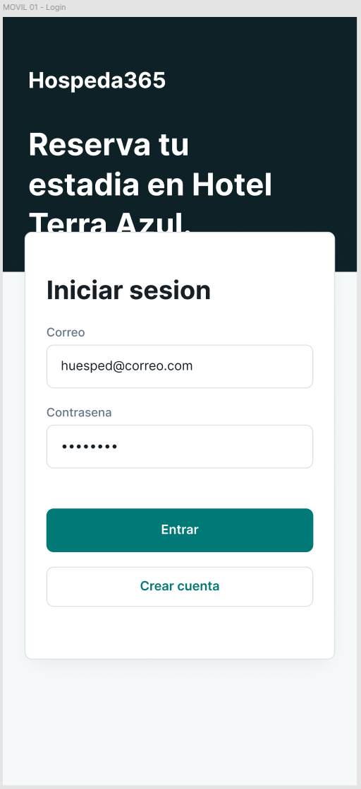
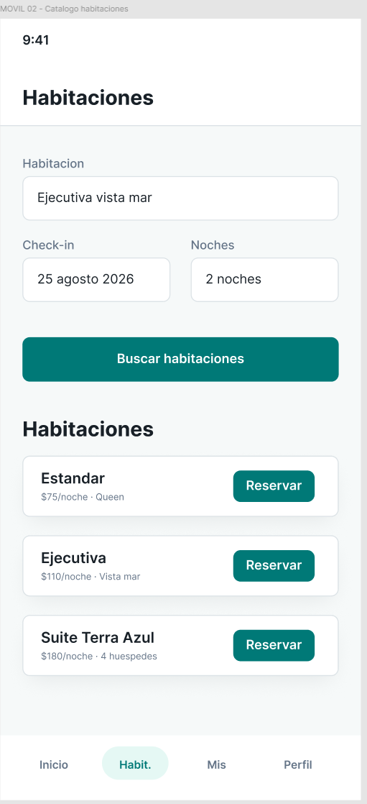
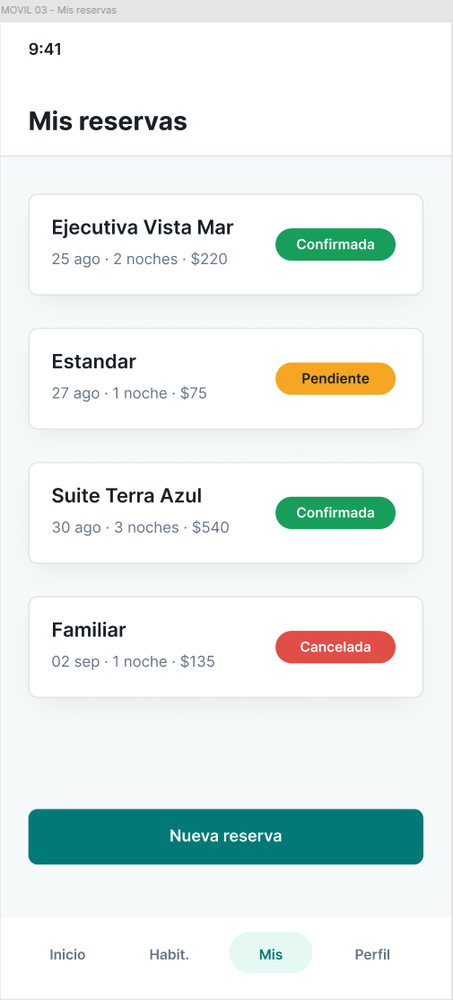
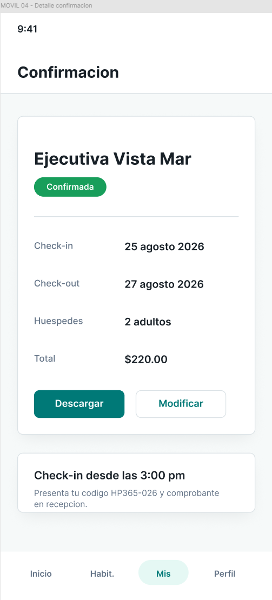

# Hospeda365 App — Hotel Terra Azul

Aplicación móvil multiplataforma desarrollada con **React Native**, **Expo** y **TypeScript** para la gestión de operaciones y reservaciones hoteleras dentro del ecosistema **Hospeda365** para el **Hotel Terra Azul**.

La aplicación permite a huéspedes y administradores acceder a funcionalidades hoteleras desde dispositivos móviles de manera rápida, intuitiva y sincronizada en tiempo real con la plataforma web.

---

## Enlaces del Proyecto:

* **Repositorio Versión Web (Next.js):** [https://github.com/al3padilla/hospeda365-web](https://github.com/al3padilla/hospeda365-web)
* **Aplicación Web en Producción (Vercel):** [https://hospeda365-web.vercel.app/](https://hospeda365-web.vercel.app/)

---

## Descripción del Proyecto:

Hospeda365 App es la versión móvil del sistema Hospeda365, diseñada para ofrecer una experiencia de usuario moderna y accesible desde dispositivos Android e iOS.

El proyecto fue desarrollado utilizando React Native y Expo, manteniendo una única base de código conectada a **Firebase** para compartir autenticación y persistencia de datos en tiempo real con el cliente web.

---

## Módulos y Sincronización Multiplataforma:

* **Autenticación completa:** Registro e inicio de sesión mediante correo electrónico y **Google** con control de acceso por roles (`huésped` y `admin`).
* **Persistencia compartida en tiempo real:** Conexión directa con Cloud Firestore (`users`, `rooms` y `bookings`) sincronizada al instante con `hospeda365-web`.
* **Módulo del Huésped:** Exploración del catálogo de habitaciones disponibles, cálculo automático de costo por estadía, carga de comprobantes de pago en Storage e historial *Mis Reservas*.
* **Operación Multiplataforma:** Actualización inmediata de estados de reservas y disponibilidad entre dispositivos móviles y el panel web.

---

## Tecnologías Utilizadas:

### Frontend Móvil
- React Native
- Expo
- TypeScript
- JavaScript ES6+

### Backend y Persistencia Compartida
- Firebase Authentication (Correo electrónico y Google)
- Cloud Firestore (Sincronización en tiempo real de `users`, `rooms` y `bookings`)
- Firebase Cloud Storage (Resguardo de comprobantes de pago)

---

## Mockups de Diseño (Etapa 1 - Figma):

[Consultar diseño original en Figma](https://www.figma.com/design/Ffof4DCOZYSizHP9uBn2H4/)

### Login y catálogo de habitaciones

<p align="center">
  
  
</p>

### Reservas y confirmación

<p align="center">
  
  
</p>
---

## Estructura del Proyecto:

```text
hospeda365-app/
│
├── assets/
│   ├── icon.png
│   ├── splash.png
│   └── imágenes del proyecto
│
├── docs/
│   └── mockups/
│
├── App.tsx
├── app.json
├── index.ts
├── LICENSE
├── package.json
├── tsconfig.json
└── README.md
```

---

## Instalación:

### 1. Clonar el repositorio

```bash
git clone [https://github.com/al3padilla/hospeda365-app.git](https://github.com/al3padilla/hospeda365-app.git)
```

### 2. Entrar al proyecto

```bash
cd hospeda365-app
```

### 3. Instalar dependencias

```bash
npm install
```

### 4. Ejecutar el proyecto

```bash
npx expo start
```

---

## Ejecución en Dispositivo:

### Android

```bash
npx expo start --android
```

### iOS

```bash
npx expo start --ios
```

### Web

```bash
npx expo start --web
```

---

## Equipo de Desarrollo (EcoTech Solutions):

Integrantes:

- Alexander Ulises Elías Vásquez | EV210855
- Marlene Noemy López de Servando | LQ221481
- Jonathan Américo Merino Medina | MM221719
- Alexandra Guadalupe Padilla Ramírez | NR221019
- Jason Oswaldo Sosa Hernández | SH210738

---

## Licencia:

Este proyecto está protegido bajo la licencia **Creative Commons Atribución-NoComercial-CompartirIgual 4.0 Internacional (CC BY-NC-SA 4.0)**.

[](http://creativecommons.org/licenses/by-nc-sa/4.0/deed.es)

Consulta el archivo [LICENSE](./LICENSE) para más detalles sobre los términos de uso.
